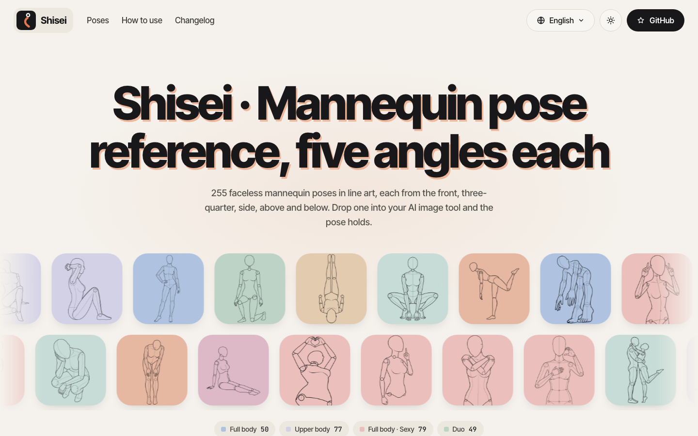

<div align="center">

<a href="https://shisei.indaloop.app/en/"></a>

# Shisei 姿勢

**A free (CC0) mannequin pose reference library: 280 poses in four series × 5 camera angles, drawn as clean line art
for Nano Banana, ChatGPT, ComfyUI, Midjourney and other AI image tools.**

English · [简体中文](docs/readme/README.zh-CN.md) · [日本語](docs/readme/README.ja.md) · [한국어](docs/readme/README.ko.md)

**[Open the gallery](https://shisei.indaloop.app/en/) · [Download all, w900 (34.1 MB)](https://github.com/wquguru/shisei/releases/download/v0.3.0/shisei-all-v0.3.0.zip) · [Other downloads](#downloads)**

[](data/catalog.json)
[](docs/GENERATION.md)
[](docs/GENERATION.md)
[](data/catalog.csv)
[](web)
[](LICENSE-images)
[](LICENSE)

</div>

---

> **Content note:** the sexy and duo series are suggestive adult pose references (faceless mannequins, no
> nudity detail). They stay out of previews and search pages, and the gallery shows them blurred until you tap one
> or flip the switch.

[](https://shisei.indaloop.app/en/)

Shisei is a self-made pose reference library. Every pose is a faceless mannequin drawn from five angles — front,
three-quarter, side, above and below — so you can feed the same pose to an image model from whichever camera you
need. Names and categories come in Japanese, Chinese, English and Korean.

All images are original to this project.

## What's inside

| Series | Poses shown | Views that passed QC | On the site |
|---|---:|---:|---|
| Full body · standard (`std`, P###) | 71 of 73 | 287 / 365 | shown |
| Upper body (`upper`, U###) | 80 of 80 | 337 / 400 | shown |
| Full body · sexy (`sexy`, S###) | 80 of 80 | 323 / 400 | blurred until tapped or switched on |
| Duo (`duo`, D###) | 49 of 55 | 186 / 275 | blurred until tapped or switched on |

Poses rated `suggestive` (the sexy and duo series, upper's Sexy and Chest emphasis) are blurred in the gallery by default and kept off
the marquee, pose pages, share cards and sitemap; tap one to see it, or one switch shows them all.

- **Every view is reviewed** ([docs/qc/](docs/qc/README.md)). A view that fails (nipple marks, a face or hair,
  clothing, background, broken anatomy, the wrong camera angle, a figure that reads as a minor, or a drawing that is not
  the named pose) is removed
  from `images/` and the catalog, and `data/qc.json` keeps the reason.
- 43 sets were redrawn by a second generator where the original had at most two usable views or showed another pose
  (catalog `source: digi`, a slightly different mannequin with milder high and low angles; whole sets, never mixed).
  P038 and P052 still show a different pose from their name and stay hidden.
- Views that were never generated stay empty rather than being filled with a bad drawing.
- **89 photo renders** for std P001–P022 and P050 (P019, P020 and P022 are off: they show the old drawing), reviewed like the line art: AI-generated adults, not real people.
- `data/catalog.json` / `catalog.csv`: series, rating, category and name in four languages, an English pose
  description for std, the file for each view, and why a view is empty.

## Using the images

Upload a view as the pose or composition reference in your image tool. Using several angles of the same pose keeps
the figure consistent across shots. Face, clothing and background come from your prompt or other references.

| Tier | Where | Size | Typical file |
|---|---|---|---|
| `w300` | `images/*/w300/` | 300 px wide | ~7 KB |
| `w600` | `images/*/w600/` | 600 × 800 | ~17 KB |
| `w900` | `images/*/w900/` | 900 × 1200 | ~29 KB |
| full | [original zip](#downloads) | 1344 × 1792 (photos 1120 × 2240, redrawn sets 900 × 1200) | ~100 KB |

The repository holds the three web tiers (about 63 MB). The full-size originals and ready-made zips are on the
[Releases](https://github.com/wquguru/shisei/releases) page.

### Downloads

v0.3.0, the same files the gallery's download panel offers. Each holds the w900 tier, line art and photo renders, of
the views that passed QC, plus LICENSE, LICENSE-images and NOTICE; a `.sha256` sits next to each zip.

| Pack | Sets | Images | Size |
|---|---:|---:|---:|
| [All series](https://github.com/wquguru/shisei/releases/download/v0.3.0/shisei-all-v0.3.0.zip) (recommended) | 280 | 1222 | 34.1 MB |
| [Full body · standard](https://github.com/wquguru/shisei/releases/download/v0.3.0/shisei-std-v0.3.0.zip) | 71 | 376 | 9.0 MB |
| [Upper body](https://github.com/wquguru/shisei/releases/download/v0.3.0/shisei-upper-v0.3.0.zip) | 80 | 337 | 9.4 MB |
| [Full body · sexy](https://github.com/wquguru/shisei/releases/download/v0.3.0/shisei-sexy-v0.3.0.zip) (suggestive) | 80 | 323 | 8.5 MB |
| [Duo](https://github.com/wquguru/shisei/releases/download/v0.3.0/shisei-duo-v0.3.0.zip) (suggestive) | 49 | 186 | 7.1 MB |
| [Originals, full size](https://github.com/wquguru/shisei/releases/download/v0.3.0/shisei-original-v0.3.0.zip) | 280 | 1222 | 144.8 MB |

## Gallery

`web/` is a zero-dependency static gallery built from the catalog: series tabs with categories inside a
series, an angle filter, a line-art / photo switch, a by-pose or single-image view, a switch that unblurs the
suggestive series, a lightbox with keyboard and swipe navigation and a line-art / photo / compare mode, a page per
pose, four UI languages and a dark theme. The spec is in [docs/DESIGN.md](docs/DESIGN.md).

```bash
python3 tools/build_site.py --link-images      # writes site/ (images symlinked for a fast preview)
python3 -m http.server 8000 -d site            # http://localhost:8000
python3 -I tools/build_site.py --public --site https://shisei.indaloop.app   # deploy build with images and share cards
```

Deep links open the lightbox directly: `#P001-diag`, `#P001-diag-photo`, `#P001-diag-compare`; filters live in the
query string (`?lang=ja&series=std&cat=5&angle=1&src=photo`).

## Layout

```
data/       catalog.json, catalog.csv — the source of truth
images/     line/ and photo/, each with w300/, w600/ and w900/ tiers
web/        static gallery source (index.html, app.js, app.css, i18n.js, common.js, changelog.yaml)
tools/      build_images.py, build_site.py, verify.py, import_series.py, qc_merge.py, review_sheets.py, pack_release.py, …
docs/       DESIGN, DECISIONS, GENERATION, LICENSING, translated READMEs, logo, screenshot
```

Check that the catalog and the images agree:

```bash
python3 tools/verify.py
```

Contributions are welcome: read **[CONTRIBUTING.md](CONTRIBUTING.md)** first (coding agents also follow
**[AGENTS.md](AGENTS.md)**). Please report security issues privately as described in [SECURITY.md](SECURITY.md).

## Status and roadmap

Shisei is at **v0.3.0**: four series and 280 poses; the catalog is stable and IDs never change. Release notes are
in [CHANGELOG.md](CHANGELOG.md); open questions in [docs/DECISIONS.md](docs/DECISIONS.md).

| Milestone | State |
|---|---|
| 73 standard poses × 5 angles, catalog, web tiers, verify | ✅ v0.1.0 |
| Upper body, sexy and duo series, each view reviewed | ✅ v0.2.0 |
| Photo renders, after their own QC pass (D-03) | ✅ public |
| Public gallery at [shisei.indaloop.app](https://shisei.indaloop.app/en/) (Cloudflare Pages) | ✅ live |
| 43 sparse or mislabelled sets redrawn as whole sets (D-09) | ✅ v0.3.0 |
| P038 and P052: the drawing is another pose | ☐ open |
| Fill the P062 *below* view | ☐ open |

## Acknowledgements

The gallery uses [Inter Tight](https://fonts.google.com/specimen/Inter+Tight),
[Noto Sans SC](https://fonts.google.com/noto/specimen/Noto+Sans+SC) and
[JetBrains Mono](https://www.jetbrains.com/lp/mono/) (SIL OFL 1.1), served by Google Fonts, and
[shields.io](https://shields.io) badges in this README. Licensing rules are in [docs/LICENSING.md](docs/LICENSING.md).

The pose list — which poses, their numbering (`orig_id`), names and categories — follows the public catalog of
[ai-pose-gallery](https://ai-pose-gallery.pages.dev/) by [ギア (@giaaibusi)](https://x.com/giaaibusi); the Chinese, English and Korean names are translations of it. Thank you. Only the list
is shared: every image here was made for this project. Shisei is not affiliated with or endorsed by its author.

## Notes

Every image was made for this project; none are copied, traced or derived from other pose collections. The figures
are mannequins or AI-generated adults and do not depict real people. Do not use them to depict real people or minors,
or for explicit content. Image metadata is stripped.

## License

- **Images** (`images/` and the Release zips) and the project's own data in `data/` are dedicated to the public domain
  under [CC0 1.0](LICENSE-images): use, modify and redistribute them, commercially or not, with no attribution needed.
- **Code and documentation** are licensed under the [Apache License 2.0](LICENSE).
- **The pose list** (selection, numbering, names and categories) comes from ai-pose-gallery's catalog and is credited,
  not licensed: neither licence covers it. See [NOTICE](NOTICE).

Using the images as a pose reference puts no conditions on the images you generate.
