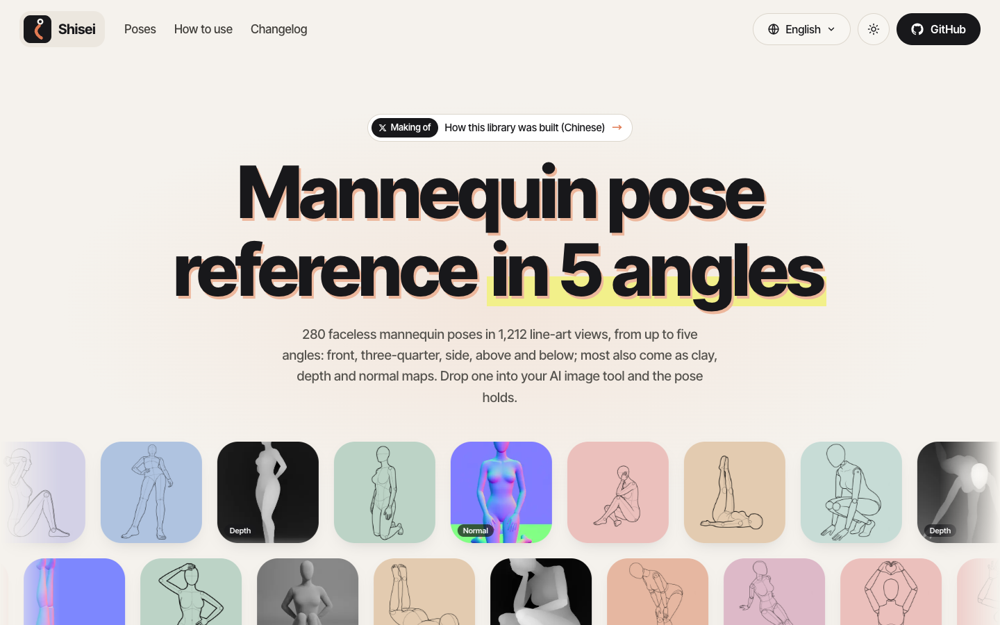

<div align="center">

<a href="https://shisei.indaloop.app/"></a>

# Shisei 姿勢

**免费（CC0）姿势线稿库：四个系列 280 套无脸素体姿势，每套 5 个机位；大部分机位另有白模、深度图和法线图。可直接喂给 Nano Banana、ChatGPT、ComfyUI、Midjourney 等 AI 绘图工具。**

[English](../../README.md) · 简体中文 · [日本語](README.ja.md) · [한국어](README.ko.md)

**[打开画廊](https://shisei.indaloop.app/) · [下载线稿（36.5 MB）](https://github.com/wquguru/shisei/releases/download/v0.4.1/shisei-all-v0.4.1.zip) · [其他下载](#下载)**

[](../../data/catalog.json)
[](../GENERATION.md)
[](../GENERATION.md)
[](../GENERATION.md)
[](../../data/catalog.csv)
[](../../web)
[](../../LICENSE-images)
[](../../LICENSE)

</div>

---

> **内容提示：**全身・性感和双人系列是偏性感的成人姿势参考（素体人偶，无裸露细节），不进预览和搜索页面，图库里默认模糊显示，点单张或打开开关才看得清。

[](https://shisei.indaloop.app/)

Shisei 是一套自己生成的姿势参考库。每个姿势都是无脸素体，画了正面、斜侧、侧面、俯视、仰视五个机位，需要哪个角度就拿哪张喂给模型。姿势名和分类有日、中、英、韩四种语言。

全部图片均为本项目原创。

## 内容

| 系列 | 显示的套数 | 质检通过的机位 | 页面上 |
|---|---:|---:|---|
| 全身・标准（`std`，P###） | 71 / 73 | 300 / 365 | 默认显示 |
| 上半身（`upper`，U###） | 80 / 80 | 359 / 400 | 默认显示 |
| 全身・性感（`sexy`，S###） | 80 / 80 | 352 / 400 | 默认模糊，点按或开关显示 |
| 双人（`duo`，D###） | 49 / 55 | 201 / 275 | 默认模糊，点按或开关显示 |

标为 `suggestive` 的姿势（全身・性感、双人，上半身的性感系、胸线强调系）在图库里默认模糊，不进首屏滚动方块、姿势页、分享卡和 sitemap；点单张可单独查看，一个开关就能全部显示。

- **每个机位都过了质检**（[docs/qc/](../qc/README.md)）。有乳头标记、五官或头发、衣物、背景、结构畸形、机位不对、人物看起来像未成年，或者画的不是这个姿势的，都从 `images/` 和 catalog 里拿掉了，原因记在 `data/qc.json`。
- 原画只有两个以下可用机位、或画的不是这个姿势的 43 套，用另一个生成源整套重画（catalog 里 `source: digi`；素体略有不同，俯视、仰视角度更缓；整套替换，不混用）。P038、P052 仍然和名字对不上，继续不显示。
- 没生成出来的机位宁可留空，也不放一张画错的。
- **89 张实拍**，覆盖 std 的 P001–P022 和 P050（P019、P020、P022 拍的是旧画的姿势，已拿掉），和线稿一样过了质检，都是 AI 生成的成年人物，不对应任何真人。
- **白模、深度图、法线图**：944 个线稿机位（270 套）各有一份，按线稿做成、逐像素对齐：白模是带体积明暗的灰色人台，深度图和法线图给 ControlNet 用。和线稿一样过了质检，大图里可以切换。
- `data/catalog.json` 和 `catalog.csv` 里有系列、分级、四语分类和名称、std 的英文姿势描述、每个机位的文件，以及机位为空的原因。

## 怎么用

把某个机位的图上传到绘图工具的姿势参考或构图参考里。同一个姿势换几个机位连着用，人物姿态更一致。脸、服装和背景用提示词或别的参考图补。

| 档位 | 位置 | 尺寸 | 单张约 |
|---|---|---|---|
| `w300` | `images/*/w300/` | 宽 300 | 7 KB |
| `w600` | `images/*/w600/` | 600×800 | 17 KB |
| `w900` | `images/*/w900/` | 900×1200 | 29 KB |
| 原图 | [原图包](#下载) | 1344×1792（实拍 1120×2240，重画的套 900×1200） | 100 KB |

仓库里放的是网页用的三档：姿势约 145 MB（线稿、实拍和白模、深度、法线），另有服装库约 150 MB。大多数人下压缩包就够了。原图和打好的压缩包在 [Releases](https://github.com/wquguru/shisei/releases) 页面。

### 下载

v0.4.1，和画廊下载面板里的是同一批文件。除原图包外，每个包都是质检通过的机位的 900 px 档，外加 LICENSE、LICENSE-images 和 NOTICE，旁边各有一个 `.sha256`。大多数人只要线稿包。白模、深度、法线没有原图包：它们本来就是 900 px。

| 压缩包 | 内容 | 套数 | 图片 | 大小 |
|---|---|---:|---:|---:|
| [线稿 · 全部系列](https://github.com/wquguru/shisei/releases/download/v0.4.1/shisei-all-v0.4.1.zip)（推荐） | 线稿 + 实拍 | 280 | 1301 | 36.5 MB |
| [全部格式 · 全部系列](https://github.com/wquguru/shisei/releases/download/v0.4.1/shisei-complete-v0.4.1.zip) | 线稿、实拍、白模、深度、法线 | 280 | 4133 | 69.0 MB |
| [白模 · 全部系列](https://github.com/wquguru/shisei/releases/download/v0.4.1/shisei-clay-v0.4.1.zip) | 白模 | 270 | 944 | 9.2 MB |
| [深度 · 全部系列](https://github.com/wquguru/shisei/releases/download/v0.4.1/shisei-depth-v0.4.1.zip) | 深度图，给 ControlNet Depth | 270 | 944 | 7.1 MB |
| [法线 · 全部系列](https://github.com/wquguru/shisei/releases/download/v0.4.1/shisei-normal-v0.4.1.zip) | 法线图，给 ControlNet Normal | 270 | 944 | 16.2 MB |
| [全身・标准](https://github.com/wquguru/shisei/releases/download/v0.4.1/shisei-std-v0.4.1.zip) | 线稿 + 实拍 | 71 | 389 | 9.4 MB |
| [上半身](https://github.com/wquguru/shisei/releases/download/v0.4.1/shisei-upper-v0.4.1.zip) | 线稿 | 80 | 359 | 10.0 MB |
| [全身・性感](https://github.com/wquguru/shisei/releases/download/v0.4.1/shisei-sexy-v0.4.1.zip)（偏性感） | 线稿 | 80 | 352 | 9.3 MB |
| [双人](https://github.com/wquguru/shisei/releases/download/v0.4.1/shisei-duo-v0.4.1.zip)（偏性感） | 线稿 | 49 | 201 | 7.7 MB |
| [原图](https://github.com/wquguru/shisei/releases/download/v0.4.1/shisei-original-v0.4.1.zip) | 线稿 + 实拍，原始尺寸 | 280 | 1301 | 152.3 MB |

## 画廊

`web/` 是从 catalog 生成的零依赖静态画廊：系列标签（选了系列后再按分类筛）、机位筛选、线稿 / 实拍切换、按套或单张浏览、一键取消性感系列的模糊、支持键盘和滑动并可切换线稿 / 实拍 / 对照的大图灯箱、每个姿势一个页面、四种界面语言和深色模式。规格见 [DESIGN.md](../DESIGN.md)。

```bash
python3 tools/build_site.py --link-images      # 生成 site/（图片用符号链接，预览快）
python3 -m http.server 8000 -d site            # http://localhost:8000
python3 -I tools/build_site.py --public --site https://shisei.indaloop.app   # 部署用构建，含图片和分享卡
```

深链接直接打开大图：`#P001-diag`、`#P001-diag-photo`、`#P001-diag-compare`；筛选条件在查询串里（`?lang=zh&series=std&cat=5&angle=1&src=photo`）。

## 目录

```
data/       catalog.json、catalog.csv：唯一的数据源
images/     line/ 和 photo/，各有 w300/、w600/ 和 w900/ 三档
web/        静态画廊源码（index.html、app.js、app.css、i18n.js、common.js、changelog.yaml）
tools/      build_images.py、build_site.py、verify.py、import_series.py、qc_merge.py、review_sheets.py、pack_release.py 等
docs/       DESIGN、DECISIONS、GENERATION、LICENSING、各语言 README、logo、截图
```

检查 catalog 和图片是否一致：

```bash
python3 tools/verify.py
```

欢迎贡献：请先读 **[CONTRIBUTING.md](../../CONTRIBUTING.md)**（编程 agent 另外遵守 **[AGENTS.md](../../AGENTS.md)**）。安全问题请按 [SECURITY.md](../../SECURITY.md) 私下报告。

## 状态与路线

当前 **v0.4.0**：四个系列共 280 套姿势，catalog 已稳定，编号不会变。发布说明见 [CHANGELOG.md](../../CHANGELOG.md)，待定事项见 [DECISIONS.md](../DECISIONS.md)。

| 里程碑 | 状态 |
|---|---|
| 73 套标准姿势 × 5 机位、catalog、网页图档、校验 | ✅ v0.1.0 |
| 上半身、性感、双人系列，逐机位质检 | ✅ v0.2.0 |
| 实拍图过质检后公开（D-03） | ✅ 公开 |
| 公开画廊 [shisei.indaloop.app](https://shisei.indaloop.app/)（Cloudflare Pages） | ✅ 已上线 |
| 43 套机位过少或画错姿势的整套重画（D-09） | ✅ v0.3.0 |
| 944 个机位的白模、深度图、法线图，和线稿对齐 | ✅ v0.4.0 |
| P038、P052：画的是别的姿势 | ☐ 未解决 |
| 补上 P062 仰视 | ☐ 未解决 |

## 致谢

画廊使用 [Inter Tight](https://fonts.google.com/specimen/Inter+Tight)、[Noto Sans SC](https://fonts.google.com/noto/specimen/Noto+Sans+SC) 和 [JetBrains Mono](https://www.jetbrains.com/lp/mono/)（SIL OFL 1.1，由 Google Fonts 提供），README 徽章来自 [shields.io](https://shields.io)。授权规则见 [LICENSING.md](../LICENSING.md)。

姿势目录（收录哪些姿势、编号 `orig_id`、名称和分类）沿用 [ギア (@giaaibusi)](https://x.com/giaaibusi) 的 [ai-pose-gallery](https://ai-pose-gallery.pages.dev/) 公开目录，中文、英文、韩文名是它的译名，在此致谢。沿用的只有目录，这里的图片全部是本项目自己制作的。本项目与原作者没有关联，也未获其背书。

## 说明

所有图片都是为本项目制作的，没有从其他姿势图库复制、描摹或派生。人物是素体或 AI 生成的成年人，不对应任何真人。请勿用这些图表现真实人物或未成年人，也不要用于露骨内容。图片元数据已清除。

## 许可证

- **图片**（`images/` 和 Release 里的压缩包）以及 `data/` 里本项目自己的数据，以 [CC0 1.0](../../LICENSE-images) 放弃权利：可以随意使用、修改和再分发，包括商用，不需要署名。
- **代码和文档**采用 [Apache License 2.0](../../LICENSE)。
- **姿势目录**（选题、编号、名称和分类）来自 ai-pose-gallery 的目录，这里只注明出处，不在上面两个许可证的范围内，见 [NOTICE](../../NOTICE)。

拿这些图当姿势参考生成的图片不受任何附加条件约束。
